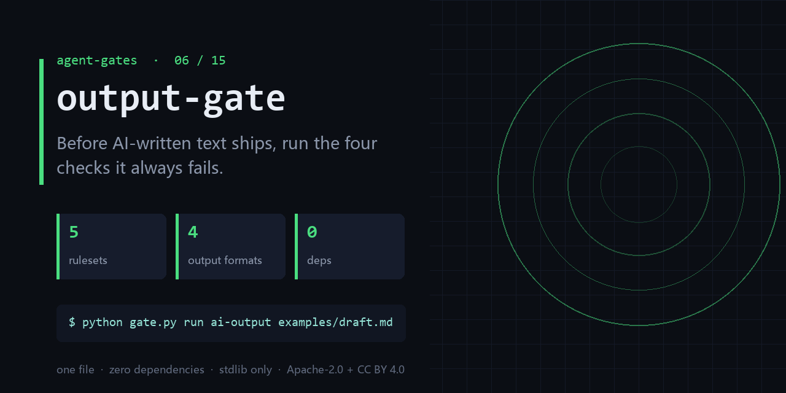

<div align="center">

</div>

<h1 align="center">output-gate</h1>

<p align="center"><b>Before AI-written text ships, run the four checks it always fails.</b><br><sub>one file · zero dependencies · stdlib only</sub></p>

<p align="center"><a href="https://github.com/chenhz01/output-gate/actions/workflows/gate.yml"></a>   </p>

---

## The failure this catches

- The delivery doc still contains '[TBD]' and an 'about 30%' that nobody verified.
- Page 3 says the budget is 80k; page 11 says 120k.
- Placeholders, fake citations, unit drift — a human has to read every page to catch them.

One command, on a file you already have:

```bash
python gate.py run ai-output examples/draft.md --format text
```

<details>
<summary><b>Real output</b> — produced by the bundled <code>examples/</code>, not a mock-up</summary>

```text
==========================================================================
output-gate · 规则集 ai-output v1.1.0
目标：客户方案 v3
场景：AI 产出通用体检
==========================================================================
✗ [PLACEHOLDER](project_custom) 存在未替换的占位符（TBD/待补/XXX/{{}}）—— 发出去就是半成品
      → 2 处占位符未替换：第10行 待补、第11行 TBD
✓ [CODEBLOCK-UNCLOSED](project_custom) 代码块未闭合（``` 数量为奇数）
      → 0 处代码块均闭合
– [BRACKET-UNBALANCED](project_custom) 代码括号不平衡（() [] {} 未配对）—— 直接导致无法运行
      → 非代码文件，不适用
✓ [SECRET-LEAK](project_custom) 疑似密钥/令牌泄漏（sk-…、api_key、token=、private key）
      → 未检出疑似凭据
✓ [PII-LEAK](project_custom) 疑似个人信息（手机号/身份证/银行卡）—— 需人判断是否为公开信息
      → 未检出个人信息特征
⚠ [CLAIM-NO-SOURCE](project_custom) 含统计数字的断言没有出处标记 —— 读者无法验证
      → 2/7 条含数字无出处（29% ≥ 15%）。例：第4行「整体预算约 30 万，其中开发占 60%」；第14行「历史版本预算为 8 万，本版调整为 12 万」
✓ [CLAIM-ABSOLUTE](project_custom) 不可验证的绝对化表述（一定/绝对/100%/永久/零风险）
      → 无绝对化表述
✓ [STRUCTURE-SHALLOW](project_custom) 标题层级过浅（无 h2 及以下）—— 多半是平铺直叙，难读
      → 5 个标题，4 个二级及以下
⚠ [SIZE-ANOMALY](project_custom) 篇幅异常（过短疑似敷衍 / 过长疑似灌水）
      → 仅 16 行，低于 20 行 —— 疑似敷衍
✓ [COMPLETION-NO-EXIT](project_custom) 自报完成（已完成/跑通/全部通过…）但全文无任何退路声明（未通过怎么办/回滚/降级/视为未完成）——按 ZEG 降级为「未验证的自报」而非完成
      → 无自报完成表述（ZEG 不适用）
--------------------------------------------------------------------------
合计 10 条：BLOCK 1 ｜ WARN 2 ｜ NEEDS_VALIDATION 0 ｜ INFO 0 ｜ PASS 6 ｜ SKIP 1
  ⛔ 本规则集做【形式与可追溯性】检查，不判断内容对错
  ⛔ WARN 项需人判断 —— 不要把 WARN 当成「有问题」的证据
  ⛔ 「无源数字」不等于「数据是假的」，只等于「读者无法验证」
结论：不通过（存在 BLOCK 项），先修再发布。
```

</details>

## What it does

- Rule-driven checks: placeholders, unsourced numbers, numeric conflicts, unit drift.
- Emits text / json / sarif / junit — SARIF lands straight in code scanning.
- Keeps a coverage ledger across runs: what newly failed, what you actually fixed.

## What it does **not** do

- It does not verify facts. It only checks that numbers declare a source.
- Rulesets are opinionated and domain-bound (ai-output, design, ecommerce, music, shortvideo).
- It will not catch a plausible lie written fluently.

Being explicit here is cheaper than a wrong expectation later.

## Exit codes

`0` = no blocking finding; `1` = at least one BLOCK rule fired.

## Install

```bash
git clone https://github.com/chenhz01/output-gate
cd output-gate
python gate.py --help
```

Python 3.9+. Nothing to `pip install` — stdlib only.

## Use it in CI

```yaml
- name: output-gate
  run: python gate.py run ai-output examples/draft.md --format text
```

`action.yml` is included, so you can also reference the repo directly as a composite action.

## 中文速览

**产出体检门** — AI 写的东西发出去之前，先跑一遍它最常犯的四类错。

- 交付文档里留着「[待补充]」和一个没人核过的「约 30%」。
- 同一份方案里，第 3 页说预算 8 万，第 11 页说 12 万。
- 占位符、伪引用、单位错乱——每一份都要人肉读一遍才发现。

一行命令：`python gate.py run ai-output examples/draft.md --format text`

边界：It does not verify facts. It only checks that numbers declare a source.

## The gates

| # | gate | what it stops |
|---|---|---|
| 02 | **[loop-gate](https://github.com/chenhz01/loop-gate)** | Find where your agent looped, before it burns another run |
| 03 | **[permission-gate](https://github.com/chenhz01/permission-gate)** | Score how much more your agent can do than it should |
| 04 | **[context-gate](https://github.com/chenhz01/context-gate)** | Measure what truncation deletes, before the model starts guessing |
| 05 | **[instruction-gate](https://github.com/chenhz01/instruction-gate)** | Two of your instructions contradict each other. This finds them |
| 06 | **output-gate** ← you are here | Before AI-written text ships, run the four checks it always fails |
| 07 | **[memory-expiry-gate](https://github.com/chenhz01/memory-expiry-gate)** | Give every memory a TTL, then prove the expiry semantics actually hold |
| 08 | **[drift-gate](https://github.com/chenhz01/drift-gate)** | When embeddings drift, retrieval quietly rots. Fingerprint it |
| 09 | **[price-gate](https://github.com/chenhz01/price-gate)** | Your cost model is only as good as the price table under it |
| 10 | **[complexity-ceiling](https://github.com/chenhz01/complexity-ceiling)** | Per-file complexity budgets that fail the build instead of the reviewer |
| 11 | **[deadcode-gate](https://github.com/chenhz01/deadcode-gate)** | Quantify how much of the repo is dead, instead of guessing |
| 12 | **[docrot-gate](https://github.com/chenhz01/docrot-gate)** | Docs don't die at once. They rot one stale command at a time |
| 13 | **[leak-gate](https://github.com/chenhz01/leak-gate)** | Scan for internal detail before the doc leaves the building |
| 14 | **[backup-gate](https://github.com/chenhz01/backup-gate)** | A backup you have never verified is a rumor |
| 15 | **[trail-gate](https://github.com/chenhz01/trail-gate)** | Hash-chained agent audit trail — and it verifies its own chain |

## License

- Code: **Apache-2.0** — see [LICENSE](LICENSE)
- Docs and example data: **CC BY 4.0** — see [LICENSE-SPEC](LICENSE-SPEC)

Attribution required when you redistribute the documentation; code can be used commercially
without a separate agreement. See [NOTICE](NOTICE).
